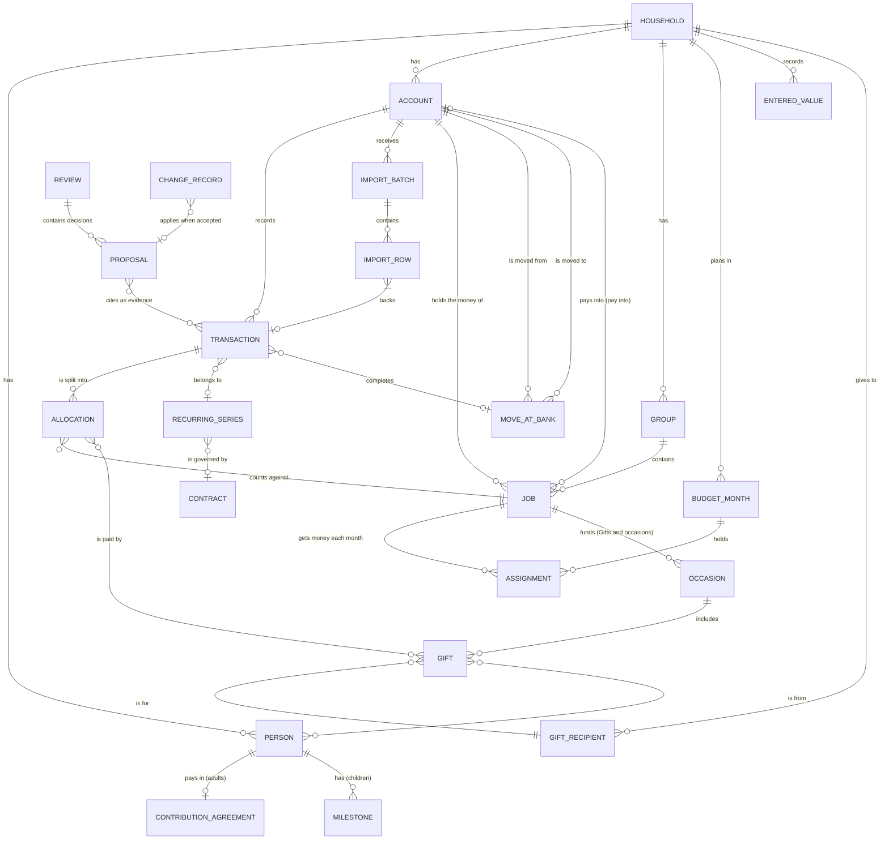

# Holt: v1 scope and domain model (v0.6, 8 Nov 2026)

Companion to `product-direction.md`. Part 1 sets out what the first release includes and how we'll know it works. Part 2 describes the objects the app deals with and the rules that must always hold. It stays at the level of product behaviour; the technical choices are in `technical-decisions.md`.

---

# Part 1: v1 scope

## What v1 is for
One household (the first household, a family in Norway) runs its shared money through the app every month: import, give every unit of money a job, review, adjust. It does this privately on a Linux desktop, with a local assistant that explains and suggests but never acts on its own.

## How we'll know it works
| Measure | Target |
|---|---|
| Real use | Three consecutive monthly cycles completed without falling back to a spreadsheet |
| Effort | A month's imports for all shared accounts take under 10 minutes, including checking |
| Suggestion quality | By the second month, at least 90% of suggested jobs for new transactions are accepted unchanged |
| Trust | Every account reconciles with the bank's closing balance; every figure the assistant mentions can be traced to its transactions |
| Estimates | Every estimated amount shows how the app worked it out, and the family can override any month |
| Safety | No data leaves the machine; every change can be undone |

## In v1
| Area | Included |
|---|---|
| Setup | All seven steps. Step 6 ("bigger picture") can be skipped. The first import can bring in history from the start of the year (about 10 months). Transactions before the plan's first month are history (decision 10). The estimates and recurring detection use them, and they never wait in "needs you". Setup ends with a backup folder and the recovery code (decision 14). |
| Transactions (formerly Import) | CSV for Bulder and SpareBank 1 SR-Bank; OFX where a bank offers it; per-account "up to date" status; duplicate detection; balance check; undo a whole import; import reminders; Needs you, All and Imports tabs |
| Plan | Groups, jobs (spend / save up / pay into another account), the buffer, buckets, unassigned money, the New job flow with "where it comes from", contributions per adult, children's accounts paid into, stages, moves at the bank, one-off and monthly (decision 11) |
| Plan: job panel | Select any job to open its history (actual spending by month) and its estimate for the next 12 months, with how the app worked it out. For variable costs, choose **Follow the bills** or **Even it out** with a bucket (decision 6). Other spend jobs use the amount the family sets (decision 12). Apply and Undo. |
| Monthly review | Assistant draft, calculated figures, decisions applied on approval, export as markdown |
| Recurring costs | Detection, subscriptions shelf, cancel-and-watch loop, price-rise and new-charge flags, contract renewal reminders |
| Overview | Vital signs (buffer runway, savings rate, loan to value, debt to income, net worth); build readiness (basic); 12-month view of large costs and estimated winter bills, with "≈" marking estimates that link to the job panel; assistant notes |
| Ask or find | Find (plain search) and Ask (questions answered from the family's own data, showing how each answer was worked out) |
| Settings | A list of settings with defaults, not a designed screen (see below) |
| Backup | Encrypted backups to a folder you choose, made automatically after each import and each approved review, keeping older copies. If your own sync tool uploads that folder, the backups survive a lost disk. The recovery code opens them on any computer (decision 14). Essential: local-only means the family's history otherwise depends on one disk. |
| Assistant | Autonomy levels 0–2 only (calculate, explain, propose) |

## Next (v1.x), in rough order
1. Insurance: policy register, breakdowns, cover against what's at stake, quote comparison.
2. **Occasions and gifts:** a year of birthdays, Christmas and other occasions, with each gift planned by recipient, amount, occasion and who it's from, all funded by one evened-out "Gifts and occasions" bucket (decision 9).
3. What-ifs in Ask or find, with "Draft this change in Plan".
4. **Household cash-flow forecast:** money in against everything planned out, the buffer as a line, and a range of likely outcomes that widens with distance. It waits until there are 12+ months of history (decision 7).
5. PDF statements read by the local model, always checked before adding.
6. Build project scenarios (sell first, build first, bridging finance), once there is a budget.
7. Norwegian (Bokmål) interface.

## Later, or not planned
Bank connections · mobile access (a read-only view served by Holt over a private network; see `technical-decisions.md`) · links to wishlist services such as Ønsk (no public API, and fetching from them would break the no-network rule) · a private space for each adult's own finances · Obsidian integration · detailed investment tracking · splitting electricity into usage (kWh) and price · mixing currencies in one household, and converting between them (decision 15) · macOS.

## Non-goals
No cloud services. Holt never uploads anything, though you can back up to a folder that your own sync tool uploads. No financial advice. No action without approval. No gamification (streaks, badges, confetti). No figures produced by the language model. No hard-coded rates (inflation, price rises): estimates come from the family's own imports. No currency conversion, because a household has one currency (decision 15).

## Settings (v1 list)
- **Household:** people, contributions, children's birth months, milestones, the currency (until data exists) and the even-out step.
- **Accounts:** name, bank, kind, scope, import rhythm, format profile.
- **Reference lines:** debt limit, mortgage cap, instalment threshold, buffer months, savings-rate target. Each shows its source and when it was last checked.
- **Figures you entered:** incomes, outside debts, credit limits, asset values, each with an as-of date.
- **Assistant:** which local runtime and model; clear question history; how much it says unprompted.
- **Reminders:** import, review, renewals; desktop notifications on or off.
- **Appearance:** Hearth (default) / Instrument / Follow my desktop; light or dark follows the desktop; transparency (glass) on or off, off by default; language.
- **Keyboard:** single-key shortcuts on or off; reassign any key.
- **Data:** where data lives, the backup folder and how many copies to keep, restore, a new recovery code (older backups keep opening with the old one), export everything (CSV / markdown), delete everything.

---

# Part 2: Domain model

## Decisions made
**7 Nov 2026**
1. **Budget month:** calendar months, each funded by money received in the month before. November's plan uses the contributions that arrived around 20 October.
2. **Leftover money in spend jobs:** returns to unassigned at month end. Each job has a "carry over" switch (for example car running costs).
3. **Overspending:** shown, and resolved by the family at the monthly review. Never covered automatically.
4. **Users in v1:** one user on one computer. The other adult sees reviews through export. Shared use waits for the mobile and access decision.
5. **The buffer:** a save-up job with a fixed role, not a separate kind of object (see "The buffer" below).

**8 Nov 2026**
6. **Variable costs (such as electricity):** the family pays the real bills, and the plan reconciles with them. Each spend job can be planned in one of two ways:
   - **Follow the bills:** each month's assigned amount is that month's estimate.
   - **Even it out:** the same amount every month (the 12-month estimate ÷ 12, rounded up to the household's even-out step, 50 whole units of the currency by default), with a bucket that fills in cheap months and pays out in expensive ones.
   - The app never picks for the family, and never changes the amount by itself. If an evened-out bucket is heading below zero, it suggests a new amount.
7. **Where forecasts live in v1:** in each job's panel in Plan, and as estimates in the Overview's 12-month ribbon. A household-wide forecast view waits for v1.x.
8. **History at the start:** the family can import from the start of the year (about 10 months). The estimate methods below are designed to work with less than a year, and get better as history grows.
9. **Occasions and gifts (v1.x):**
   - **Manual entry.** Gifts go to anyone, inside or outside the household, so they are typed in. There is no link to wishlist services.
   - **One bucket.** A single "Gifts and occasions" job, evened out (decision 6), funds every occasion. It replaces the "Christmas and gifts" job in the mockups.
   - **Gift-level detail.** Each gift records who it's for, the amount, the occasion and who it's from.

**8 Nov 2026 (architecture review)**

10. **History and the plan start.** The family picks the first month Holt plans. Transactions before it are history, except income that funds a month from the plan start on: October's contributions still fund November. The estimates and recurring detection use them, and rules and recurring series sort them in bulk, but none of them wait in "needs you". Without this, a first import of 10 months would mean thousands of decisions before the first plan. Setup splits each account's balance at the plan start into buckets and an unbucketed remainder.
11. **Moves at the bank.** Holt never moves money. When the plan needs money in another account, it lists a move for the family to make at the bank, and an import that shows the transfer marks it done. There are two kinds:
    - *one-off*, created by a plan change, such as seeding an evened-out bucket from Buffer;
    - *monthly*, each account's share of the month's plan, such as "each payday, move 22,060 kr to Regninger".

    Without them, every bucket in an account the contributions don't reach would fail the balance check each month with no explanation (rule 6).
12. **Planning a spend job, and when its amounts stop moving.** Each spend job is planned one of three ways:
    - *Set amount:* the family's own figure, repeated each month until they change it. This is the default for jobs such as Food.
    - *Follow the bills:* each month's amount is that month's estimate.
    - *Even it out:* as in decision 6.

    Future months show projected amounts, which move with the estimates. When a month opens, its amounts become assignments, and after that only the family changes them. This is how "follow the bills" and "the app never changes the amount by itself" both hold.
13. **Over at month end (refines decision 3).** A spend job's leftover money returns to unassigned at month end unless the job keeps its money (decision 2). A negative leftover stays on the job as "over" until the family resolves it at the review. It doesn't reduce next month's money on its own.
14. **Backups and the recovery code.** Setup always makes a recovery code, even when a keyring is available, because the keyring sits on the same disk as the data. The keyring unlocks Holt day to day. The recovery code opens a backup on any other computer. The details are in `technical-decisions.md` §5 and §14.

**8 Nov 2026 (currency)**
15. **One currency for the household.** The family chooses a currency in Setup, any ISO 4217 code (NOK, EUR, USD and so on), and every account, amount and figure is in it. Holt never mixes currencies and never converts between them. Amounts are stored as whole minor units (øre, cents, whole yen), and core reads the number of minor-unit digits from the currency. A bank file or account in another currency is refused, not converted. The currency is fixed once the first transaction or entered value exists, because changing it later would relabel amounts without converting them, and could change the number of digits.
    - *Why one currency.* Any conversion needs an exchange rate. A rate needs either a network call, which Holt never makes, or a number the family types in and keeps up to date. One currency keeps every rule, balance and reconciliation exact.
    - *What would change it.* A household that earns or banks in two currencies. That is the later "mixing currencies" item, and it needs its own decision about where rates come from.

## The objects at a glance

Buckets and estimates aren't in the diagram, because the app works them out instead of storing them (see "Facts and figures").

## Rules that must always hold
Each rule names what keeps it true. The table after the list says where each is proved. Core (Milestone 2) enforces rules 1, 3, 4, 5, 6, 7, 8, 9, 10, 11 and 12. Rule 2 lands with the reply validator in Milestone 6, and rule 13 is enforced by Milestone 1's checks.

1. **Money is whole minor units, in one currency.** Amounts are stored as integers in the currency's smallest unit (øre for NOK, cents for EUR and USD, whole yen for JPY) and shown in the household's currency. The household has one currency and nothing converts. No fractions, no rounding drift.
   - Enforced by the branded `Money` type in core. Its constructor rejects anything that isn't a safe integer. Core has no conversion function, and an import refuses a file in another currency (decision 15).
2. **Figures are calculated, never written by the AI.** The language model can choose a filter, propose a change or draft words. Every number the family sees is calculated by the app, estimates included. When the model writes words, it names each figure with a placeholder, and the app fills it in.
   - Enforced by the reply validator, which rejects any digit outside a placeholder (`technical-decisions.md` §6).
3. **Every transaction in a shared account is accounted for, from the plan start on.** It is income, a transfer, or split across one or more jobs, with the splits summing exactly to the amount. Anything else sits in "needs you", in plain view. Earlier transactions are history (decision 10), except income that funds a month from the plan start on, which stays income.
   - Enforced by the transaction's treatment type in core. A split can only be built from allocations that sum to the amount.
4. **Every unit of money has a job, or is visibly unassigned.** For each month: money available = unassigned carried in + income whose funds month is this month, which is usually money received in the previous month (decision 1). Unassigned = money available − total assigned. A negative figure is shown as "over-assigned", never hidden or fixed silently.
   - Enforced by core's single function for figures, with property tests.
5. **Accounts reconcile with the bank.** The balance the app calculates must equal the closing balance in the latest import, or the balance the family typed when a file carries none. A mismatch is flagged and explained; it is never adjusted automatically.
   - Enforced by the balance check on every import. No command writes an adjustment.
6. **Buckets fit inside their account.** The buckets in an account plus its unbucketed remainder equal the account balance. The remainder cannot go below zero; if it would, the app flags that the buckets exceed the balance, and names any move at the bank still to do (decision 11).
   - Enforced by core's single function for figures, with property tests.
7. **Transfers are neither income nor spending.** Moving money between shared accounts changes nothing in the plan. Paying into an account the household pays into (a child's savings) counts as saving.
   - Enforced by the treatment type. A transfer has no allocations, and a payment into a child's account is a split to a pay-into job.
8. **Nothing changes without approval.** Assistant output is a proposal with evidence, a status and its origin. Only an accepted proposal changes data.
   - Enforced by the command model. Assistant output is only ever stored as a proposal, and only accepting it saves its command.
9. **Everything can be undone.** Every change is recorded; undo reverses it. A whole import can be undone as one unit.
   - Enforced by change records that keep each row before and after, with a property test that undo then redo gives the same figures.
10. **Entered values carry a date.** Figures entered by hand and reference settings show when they were last set or checked. After 12 months they are flagged for review.
    - Enforced by the entered-value record, whose as-of date is required. One query finds every value older than 12 months.
11. **Next month's money is not the buffer.** Money that has arrived for next month (decision 1) is shown as "next month's money". It never counts towards the buffer or the runway.
    - Enforced by the funds month on each income. Core counts income only from that month.
12. **Estimates are never actuals.** An estimate is always marked as one ("≈", "est."), always shows its method, and is replaced by the real amount once the transaction is imported. Plans compare against actuals, never against estimates.
    - Enforced by storing no estimates. Core works them out each time, and only an override is stored, marked "entered by you".
13. **Nothing leaves the machine.**
    - Enforced by one loopback-only function for all main-process HTTP, a lint rule against other network modules, and a no-network test in a loopback-only network namespace (`technical-decisions.md` §3).

### Where each rule is proved
| Rule | Test |
|---|---|
| 1. Whole minor units | `packages/core/src/money.property.test.ts` |
| 2. Figures are calculated | Reply validator, Milestone 6 (not in core) |
| 3. Every transaction accounted for | `facts.test.ts` (a split adds up) and `commands/check-facts.test.ts` |
| 4. Every unit has a job, or is unassigned | `figures/months.test.ts`, a property over random plans |
| 5. Accounts reconcile | `commands/apply.test.ts` (no command adjusts a balance); `import/plan.test.ts` and `import/balance.test.ts` (the balance check on import flags a mismatch and never adjusts) |
| 6. Buckets fit inside their account | `figures/accounts.test.ts`, a property |
| 7. Transfers are not income or spending | `figures/accounts.test.ts`, a property |
| 8. Nothing changes without approval | `proposal.test.ts` |
| 9. Everything can be undone | `commands/apply.test.ts`, a property: undo all then redo all gives the same facts and figures at every step; `change-log.test.ts`; `import/import.property.test.ts` (undoing an import restores the facts) |
| 10. Entered values carry a date | `figures/entered-values.test.ts`, `commands/entered-values.test.ts` |
| 11. Next month's money is not the buffer | `figures/buffer.test.ts` |
| 12. Estimates are never actuals | `figures/jobs.test.ts`, `estimate.test.ts` |
| 13. Nothing leaves the machine | `pnpm lint:network` and `pnpm test:no-network` (Milestone 1) |

## Facts and figures
Holt stores facts and works out figures. Only facts are saved, and undo only ever restores facts:
- transactions, import rows and allocations
- jobs, assignments and budget months
- entered values, including estimate overrides
- one-off moves at the bank, and which moves are done
- proposals and change records

Everything else is a figure that one pure function in `packages/core` works out from the facts: bucket balances, unassigned and over-assigned money, money available, next month's money, the runway, estimates, contribution status, the calculated account balances, and each account's monthly move at the bank. A year of data is a few thousand rows, so working everything out again after each change takes milliseconds. `pnpm bench:core` measures it, as a median of 100 runs on one core of a 32-thread desktop. A synthetic year of 3,547 transactions takes about 1.1 ms with the stand-in estimate and 1.8 ms with the real ones. The family's three years, 8,556 transactions with 8,500 import rows, take about 3 ms with 51 of them waiting in needs you, and about 4 ms with all of them waiting, as after a first import. The needs-you list and the import status are worked out when first read, so a pass that reads neither takes about 2 ms and 1 ms. The first pass in a new process takes 14 to 23 ms and the next eight 4 to 9 ms, while V8 optimises the code. A monthly review keeps a frozen copy of its figures, which is how it shows that they changed after approval.

## Changes are commands
Every change is a command, whether the family makes it or accepts a proposal. "Assign 3,050 kr to Electricity in December" is a command, and so is "split this transaction". Core applies a command to the facts and works out the new figures. That one step serves four places:
- **Previews.** The New job flow's knock-on effects, and What if in v1.x, apply a command without saving it.
- **Proposals.** A proposal is a command waiting for approval, with its evidence.
- **Changes.** Saving a command, whether the family's own or an accepted proposal's, writes a change record with each affected row before and after, so undo can restore them.
- **Undoing an import, or reverting from Change history.** These are new commands with their own preview, not a rewind. A later change that depends on the old one shows up in the preview instead of breaking silently.

## The objects

### Household
Name, currency, language, theme, stage (1–4, chosen by the family), the month the plan starts (decision 10) and the even-out step (decision 6).

The currency is one ISO 4217 code for the whole household (decision 15), chosen in Setup and fixed once the first transaction or entered value exists. The even-out step is the rounding for evened-out amounts, 50 whole units of the currency by default, and the family can change it. Amounts in these documents are written in NOK, because the first household uses it and the mockups do. Budget months are calendar months funded by the previous month's money (decision 1).

### Budget month
A calendar month in the plan (decision 1). Its state is one of:
- *planned:* a future month. Its amounts are projections from each job's plan, and they move with the estimates.
- *open:* the family has started assigning its money, usually when the contributions for it arrive, and on the 1st at the latest. Opening a month turns its projections into assignments (decision 12).
- *closed:* the family approved the month's review.
- *reopened:* the family reopened the review. The month closes again when they approve it.

Months before the plan start have no state. Their transactions are history (decision 10).

### Person
Display name (a nickname is fine), adult or child.
- **Children:** birth month, used for the children's timeline and, from v1.x, to suggest birthday occasions.
- **Adults:** may have a contribution agreement.

### Contribution agreement
The adult, a fixed monthly amount, the expected day, and the shared account it lands in.
- Each month the app records the status: arrived, late, short, or arrived in parts.
- It is a record, not a judgement.

### Account
- **Name and bank.**
- **Kind:** everyday, bills, savings, loan.
- **Currency:** always the household's. An account in another currency can't be added (decision 15).
- **Scope:**
  - *shared*: imported and fully tracked
  - *paid into*: for example a child's savings account. Payments in are tracked; importing it is optional, and otherwise its balance is entered by hand.
- **Import rhythm:** weekly, fortnightly or monthly.
- **Format profile.**
- **Opening balance and date.**
- **Loans:** a loan account's balance is entered by hand with a date, because SpareBank 1 SR-Bank doesn't export loan accounts (spike S4, decision record 0043). The monthly payment is one fixed-cost allocation. Principal doesn't count towards the savings rate until the family decides otherwise.

### Asset
Something the household owns that isn't an account: the house, the plot.
- Its value is an entered value (see below). It is typed by hand with a date, and every past value is kept, so trends work.

### Group
Name and order. A setting says whether its jobs count towards the savings rate. The default groups are Fixed costs, Living and Saving; families can add their own.

### Job
The core planning object. It has a name, group, kind, status (active, paused, finished, archived), and the account where its money sits. For a spend job, that is the account its bills are paid from (Regninger, for Electricity).
- **Essential (yes / no):** whether the job is needed to keep the household running. Essential jobs set the buffer's target and the runway figure.
  - Defaults: every job in Fixed costs, plus Food and household.
  - The family can change any of them.
- **Keeps its money (yes / no):** whether money left at month end stays with the job or returns to unassigned (decision 2). Save-up jobs, the buffer and evened-out jobs always keep it. For other spend jobs, this is the "Carry over" switch. The money a job keeps is its bucket.
- **Spend each month:** planned one of three ways (decision 12):
  - *Set amount:* the family's own figure, repeated each month until they change it. This is the default for jobs such as Food.
  - *Follow the bills:* the amount each month is that month's estimate.
  - *Even it out:* a fixed monthly amount (decision 6). The job keeps its money, so its bucket fills in cheap months and pays out in expensive ones.
- **Save up for something:**
  - a target amount and a "ready by" date
  - the monthly amount is calculated from them, or set directly
- **Pay into another account:** a monthly amount and the account it goes to.
- Deleting a job whose bucket holds money requires moving that money first.

### Estimate
The app's forecast of what a job will cost in a future month. Core works it out from the history whenever it's needed, and never stores it. The exception is a month the family overrides. That override is stored as an entered value and marked "entered by you". The app picks a method per job and shows it:

| Kind of cost | Method | Example |
|---|---|---|
| Fixed | The contract or recurring amount | Mortgage, Netflix |
| Seasonal, 12+ months of history | The same month last year × the trend (the last 3 months against the same 3 months a year earlier) | Electricity from November 2027 |
| Seasonal, less than 12 months | The nearest comparable months (for example November ≈ March, December ≈ the average of January and February), marked as rough | Electricity, November–December 2026 |
| Irregular | The average of the last 3–6 months | Clothes and kids |
| Planned items | The sum of planned items in that month | Gifts and occasions (from the gifts planned for each occasion) |

- Whether a job is seasonal is detected from its history and can be changed by the family.
- No outside rates (inflation, price indices) are used.

### The buffer
A save-up job with a fixed role. There is exactly one per household. It can't be deleted, only given a target of zero months. It differs from other save-up jobs in four ways:
- **Its target follows the plan.** The target is the buffer months (a reference setting, default 3) × the monthly total of essential jobs. When the plan changes, the target changes with it.
- **It has no end date and never finishes.** When it reaches its target, the app proposes what to do with its monthly amount (for example move it to build savings). It doesn't stop by itself.
- **Taking money out is an event, not spending.** A withdrawal asks for a short reason, appears in the monthly review, and comes with a proposed plan to refill it. Seeding an evened-out bucket from the buffer counts as a withdrawal, and appears as a move at the bank when the two buckets sit in different accounts.
- **It is never money to spend.** It is not shown as available in the plan, and it is the only thing counted in "How long could we last?".

*Why a job and not "whatever is left over":* a leftover buffer would shrink silently every time something overspent, and the runway figure would mean nothing. As a job it has a monthly amount, a bucket, a visible target and a history, all using the same model as everything else.

### Assignment
A month, a job and an amount. It is the plan for that month. Assignments exist only for open and closed months; planned months show projections instead (decision 12). Past months' assignments are kept, so reviews can compare plan against actual.

### Bucket
The money a job keeps in the account where its money sits. A bucket isn't stored on its own. Core works out its balance from the job's opening amount in Setup (decision 10), its assignments, the moves between buckets and the allocations against it, so nobody types it in. The interface calls it a bucket, and "Where the money sits" in Plan lists the buckets in each account.

### Bucket transfer
A move of money from one job's bucket to another's in a month the family has opened: an amount, the two jobs and a reason. Taking money out of the buffer needs a reason, and it shows in the monthly review as a withdrawal (see "The buffer"). It changes no account's balance when both buckets sit in the same account. When they sit in different accounts, the family also makes a move at the bank, and until it is made the receiving account shows its buckets as more than its balance.

### Move at the bank
A transfer the plan needs the family to make at the bank (decision 11). Holt never moves money itself.
- **What:** from which account, to which account, the amount, the month, and why.
- **Kind:**
  - *one-off:* created by a plan change, such as seeding an evened-out bucket from Buffer.
  - *monthly:* worked out from the plan. For each account, it is the month's assignments for the jobs whose money sits there, less the money that lands there directly.
- **Status:** to do, done or skipped. An imported transfer pair with the same accounts and amount, within 3 days, marks it done. The family can also mark it done or skip it.

### Transaction
- **Booking:** account, booking date, transaction date (if the bank gives one), amount, the bank's description. The booking date decides which month a transaction counts in, for spending and for the balance check alike, so bucket sums and account balances agree at every month end.
- **Who:** a cleaned-up counterparty name.
- **Source:** the import rows that back it (one, or several when files overlap), and the bank's reference (if any).
- **Treatment:** exactly one of these.
  - *Needs you:* waiting for the family.
  - *Income:* with the month it funds and its source (a contribution, a recurring series, or other). The funds month is usually the next month (decision 1). A late contribution funds the month it was meant for. The family can change it.
  - *Transfer:* with its partner transaction, or waiting until the other side is imported. It can complete a move at the bank.
  - *Split:* allocations to one or more jobs that sum exactly to the amount. A payment into a child's account is a split to a pay-into job, so it counts as saving. A refund is a split with money coming in.
  - *History:* before the plan start (decision 10). It can carry a job for the estimates, but nothing requires one.
- **Optional links:** a recurring series, a note.

### Allocation
A transaction, a job and an amount. One transaction can be split across several jobs; for example, one insurance payment covers several policies. An allocation to Gifts and occasions can also name the gift (or gifts) it paid for.

### Import batch
- **The file:** name and fingerprint, the account, the format profile.
- **What it covered:** the period, number of rows, how many were new, and how many were duplicates.
- **The check:** the closing balance in the file, and whether it matched. When the file states a currency, it must be the household's.
- **Housekeeping:** when it was imported, and whether it has been undone. Undoing an import is a new command (see "Changes are commands"). After a preview, it removes the transactions that no other import backs, with their allocations.

### Import row
One row of an imported file, kept exactly as the file had it: the batch, its position in the file, the parsed fields and a fingerprint.
- A row backs at most one transaction. When files overlap, several rows back the same transaction.
- Pending ("reservert") rows back no transaction until a later file books them.
- Importing the same file twice adds nothing, because the file's fingerprint matches the earlier import.

### Format profile
Bank, file type, column mapping, date and number formats, and which sign means money out. Each account remembers its profile, so the next file from that account needs only a check.

### Categorisation rule
- **A match:** counterparty, account, and optionally an amount range.
- **The result:** the job (or split) to suggest.
- **Origin:** set by you, learned from a correction, or an accepted assistant suggestion.
- **Priority.**

Rules run first and give the same result every time. The assistant only suggests for transactions no rule covers.

### Recurring series
- **What:** counterparty, kind (subscription, bill, income, contract), and the linked job or policy.
- **When:** how often (monthly, yearly and so on), last seen, next expected.
- **How much:** the expected amount, with its price history.
- **Status:**
  - active
  - kept (ask again in a year)
  - cancelling and watching
  - cancellation confirmed
  - review later
- If a "cancellation confirmed" series charges again, it returns to active with a flag.

### Contract
Provider, renewal or end date, how far ahead to remind, and when the family last compared prices. Electricity, mobile, mortgage rate checks, and (in v1.x) insurance policies.

### Policy and quote (v1.x)
- **Policy:** insurer, type, who or what it covers, premium and frequency, excess, sum insured, renewal date, document, linked recurring series.
- **Quote:** the policy it's an alternative to, insurer, price, excess, cover, and the date it was entered.
- **Bundle discount:** insurer and percentage, entered by the family.

### Occasion (v1.x)
Something the household gives gifts for.
- **Name and kind:** birthday, Christmas, konfirmasjon, wedding, christening, party, other.
- **Date:** one date, or yearly (most birthdays and Christmas). Household members' birthdays are suggested from their birth months; everything else is typed in.
- **Who it's about** (optional): a household member or a gift recipient, for example "Grandma's 70th". Christmas is about no one in particular.
- **Default budget** (optional): used for the estimate until gifts are planned for it.
- **Funded by** the Gifts and occasions job.

### Gift (v1.x)
One planned or bought gift.
- **For:** a gift recipient (anyone; a household member is also a recipient).
- **From:** one or more household members, or "all of us", or the children. This matters for gifts the family buys on behalf of someone else, such as a gift "from the children" to a parent.
- **Occasion.**
- **What:** a short description, an optional note, and an optional link kept as text only. Holt never opens or fetches it.
- **Amount:** the planned amount; once bought, the actual amount comes from the allocation.
- **Status:** idea → planned → bought → given. Ideas don't count towards the estimate; planned and bought do.

### Gift recipient (v1.x)
A name (a nickname is fine) and, optionally, a relationship and a birthday. Stored only on this computer. Household members appear here automatically.

### Gifts and occasions (how it fits together, v1.x)
- **One job, evened out.** The yearly estimate is the sum of planned gifts for each occasion in the next 12 months, plus the default budget of occasions with nothing planned yet. One twelfth goes into the bucket each month (decision 6), so December doesn't take the whole hit.
- **Paying for a gift.** When an import allocates a transaction to Gifts and occasions, Holt offers to link it to a planned gift. The gift becomes "bought", with the actual amount. One transaction can pay for several gifts (one shop, three presents), and one gift can be paid in parts.
- **Where it shows:**
  - In Plan, the job's panel lists the year's occasions, what's planned for each, and the bucket's path through the year (same chart as Electricity).
  - The Overview's 12-month ribbon marks occasions.
  - The monthly review lists the next two months' occasions and anything still at "idea".
- **Why manual:** gifts go to anyone, and wishlist services like Ønsk have no public API. Typing a gift takes seconds, keeps everything on the machine, and works with any wishlist.

### Reference setting
Key, value, unit, a note on where it came from, and the date it was last checked by the user. Examples: debt limit 5×, mortgage cap 90%, instalment threshold 60%, buffer months 3.

### Figure you entered
What it is (gross income, outside debt, credit limit), the value, an as-of date, and who entered it. Used only where the app can't see the number itself.

### Entered value
Reference settings, figures you entered, asset values, the balances of accounts the household pays into, and estimate overrides are all stored the same way. Each has its kind, what it is, the value, its unit, an as-of date, where it came from, and who entered it. A change adds a new row instead of replacing the old one, so every past value is kept. Rule 10's 12-month check is one query across all of them.

### Milestone
A person, a name, a date and an estimated cost (for example konfirmasjon), optionally linked to a save-up job.

### Build project
The plot (an asset), the build savings job, an optional rough budget, and the reference settings it measures against. Readiness is calculated from these; there is no deadline until the family sets one.

### Monthly review
- **Basics:** the month and its status (draft, approved, reopened).
- **What's in it:**
  - a frozen copy of the figures
  - the assistant's draft and the family's edits
  - any overspending to resolve (decision 3)
  - any money taken from the buffer, with its reason
  - evened-out buckets: their balance against the estimate, and any suggested new amount
  - upcoming occasions (v1.x)
  - the decisions taken, as proposals
- **Completeness:** which imports were missing at the time. If those arrive later, the review shows that its figures have changed since approval.

### Proposal
Anything the assistant (or the app's own detection) suggests:
- a job for a transaction
- a new rule
- a recurring-cost flag
- a cut
- a plan change (including a new amount for an evened-out job)
- a buffer refill plan
- review wording

Each carries its evidence (transactions, filter), its exact values (calculated by the app), a status (suggested, accepted, rejected, expired), the model that made it, and when it was decided.

Each proposal also holds the command it would apply (see "Changes are commands") and the version of the data it was worked out from. If that data changes before the family decides, the proposal expires and the app works it out again.

### Reminder
Type (import due, review ready, renewal, entered figure out of date, occasion coming up), due date, channel (in the app, desktop notification), state.

### Question (Ask or find history)
The question, the filter the app worked out from it, the calculated result, and the wording. Stored on this computer only; can be cleared.

### Change record
Every change: who made it (the family, or an accepted proposal), the command, each affected row before and after, and when. Undo restores the rows as they were before, if they still match how the change left them. If something changed them since, undo explains what changed instead of overwriting it.

## Awkward cases and how the app behaves
| Case | Behaviour |
|---|---|
| Transfer between two shared accounts | Matched as a pair (same amount, opposite sign, within 3 days). If only one side has been imported yet, it shows as "transfer, other side not yet imported". A pair that matches a move at the bank marks the move done. |
| One payment covers several things | Split into allocations. A rule can remember the split (for example a combined insurance invoice). |
| Refund | Money in against a spend job reduces what was spent on that job; it is not income. |
| Overlapping imports | The app keeps every file's rows. A row that matches an existing transaction, on the bank's reference or on account, amount, booking date and description, backs that transaction instead of creating a new one. Matching counts: two identical rows in one file are two transactions, and an overlapping file needs two matching rows to back both. A near match, such as a date one day apart, goes to "needs you" as a suggestion instead of merging. The covered period is merged. |
| Pending ("reservert") transactions in an export | Ignored until booked, so they are never counted twice. |
| Contribution arrives early, late, in parts or short | Counted towards that month's agreement; its status shows what happened. Nothing is chased automatically. |
| Contribution arrives after the month it was meant to fund has started | Its funds month is the month it was meant for, so it adds to that month's money available. The month's plan shows it arrived late. |
| Income paid directly into a shared account (barnetrygd) | A recurring income series. The family confirms what it is once; after that it is expected each month. |
| Cancelled subscription charges again | Back to active with a flag and a proposal: "Charged again after you cancelled". |
| A price changes on a recurring cost | Added to its price history; flagged; a proposal offers to update the job's amount. |
| A spend job goes over | Shown as over. At the review, the family chooses where to cover it from. Never moved automatically. Until then, the negative balance stays on the job and doesn't reduce next month's money (decision 13). |
| Money is taken from the buffer | Recorded as a buffer withdrawal with a reason; shown in the review with a proposed refill plan. |
| The plan changes so essentials go up | The buffer's target rises with it; the runway figure is recalculated and the change is noted in the next review. |
| Plan changed mid-month | Allowed; the history of assignments is kept, so the review shows the change. |
| A child turns 18 | When the linked income stops arriving, the app flags it and proposes updating the plan. It does not assume ahead of time. |
| A paid-into account's balance is unknown | Shown as "entered by you on [date]", with deposits since then added on top. |
| Deleting a job with money in its bucket | Not allowed until the money is moved to another job or back to unassigned. |
| The bank's balance and the app's disagree | The account is flagged; the app lists likely causes (missing period, duplicate, pending transaction). Nothing is adjusted. |
| Evening out starts just before winter | A bucket that starts empty would run dry. The app works out the smallest starting amount that keeps it above zero (with a small margin) and offers two choices: **start now** with that amount moved in (for example 4,100 kr from Buffer, listed as a move at the bank for the family to make), or **start in April**, following the bills through winter and filling the bucket over summer. |
| An evened-out bucket is heading below zero | The app shows when it would run out and proposes a new monthly amount. Nothing changes until the family accepts. A bucket that does go below zero is shown as short, like an over job, and resolved at the review. |
| Less than a year of history | Months with no comparable month last year use the nearest comparable months and are marked as rough estimates. The family can type a known figure (for example last winter's bill) for any month. |
| An actual bill arrives | It replaces that month's estimate. The job panel shows planned against actual, and the bucket (if evened out) absorbs the difference. |
| Choosing a mode leaves the month over-assigned | For example, following the bills makes November 3,300 kr when only 228 kr is unassigned. The plan shows "over-assigned", and the family moves money from another job. |
| Gifts and occasions starts in November | The same as Electricity: Christmas is close, so the bucket needs a starting amount, or Christmas this year follows the plan and evening out starts in January. |
| A gift costs more or less than planned | The bucket absorbs the difference, and the job panel shows planned against actual for the occasion. |
| A gift is bought in one month for an occasion in another | It counts when it's paid, against the bucket. The gift shows as "bought" until the occasion, then "given". |
| A gift is shared with people outside the household (a joint present) | Record only the household's share as the amount, with a note. Money others pay back arrives as a refund against the job. |
| Transactions from before the plan start | History. The estimates and recurring detection use them, rules and series sort them in bulk, and none of them wait in "needs you" (decision 10). |
| A move at the bank hasn't been made yet | It stays on the list. If the account's balance check fails, the app names the move as the likely cause. |
| The same file is imported twice | Nothing changes. The file's fingerprint matches the earlier import. |
| A bank file is in another currency | The import stops before it reads any rows and says so, for example "This file is in EUR. Your household uses NOK." Nothing is imported or converted. When a file doesn't state its currency, the household's is assumed. |
| The family wants a different currency | Allowed only in Settings → Household while no transaction or entered value exists. After that, the family exports what they want to keep, deletes everything in Settings → Data and sets up again. |
| A card payment abroad | Holt records the amount the bank booked in the account's currency. A foreign amount in the description stays as text and Holt doesn't use it. |
| A bank file has no closing balance | The family types the balance the bank shows, marked "entered by you", and the balance check uses it. Spike S4 checks which files carry one. |
| The mortgage payment | One allocation to the Mortgage job, a fixed cost. The loan's balance is entered by hand with a date, because the bank doesn't export loan accounts (0043). Principal doesn't count towards the savings rate until the family decides otherwise. |
