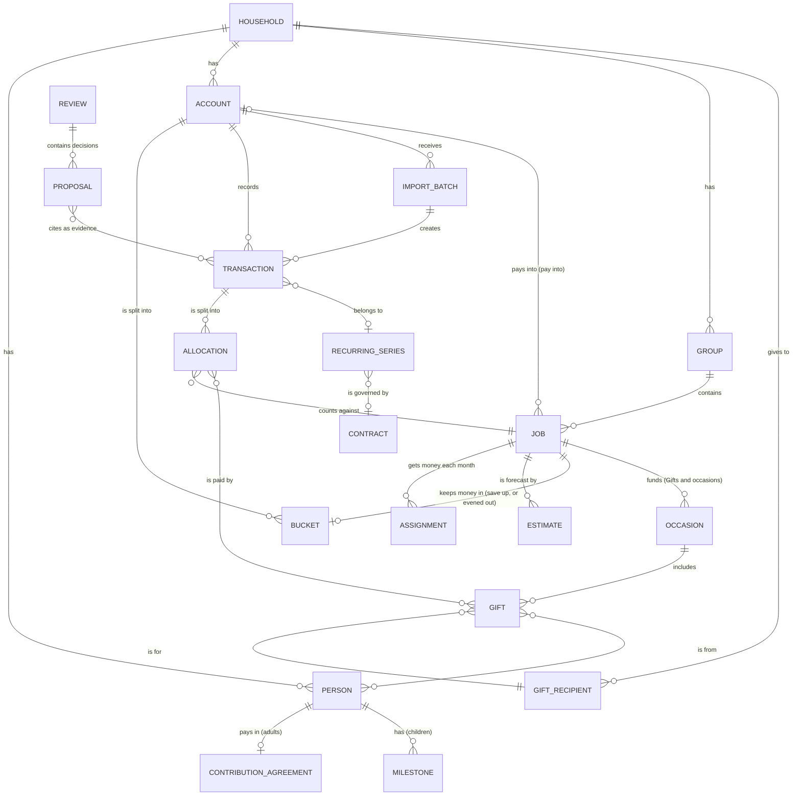

# Holt: v1 scope and domain model (v0.4, 8 Nov 2026)

Companion to `product-direction.md`. Part 1 sets out what the first release includes and how we'll know it works. Part 2 describes the objects the app deals with and the rules that must always hold. It stays at the level of product behaviour; the technical choices are in `technical-decisions.md`.

---

# Part 1: v1 scope

## What v1 is for
One household (the first household, a family in Norway) runs its shared money through the app every month: import, give every krone a job, review, adjust. It does this privately on a Linux desktop, with a local assistant that explains and suggests but never acts on its own.

## How we'll know it works
| Measure | Target |
|---|---|
| Real use | Three consecutive monthly cycles completed without falling back to a spreadsheet |
| Effort | A month's imports for all shared accounts take under 10 minutes, including checking |
| Suggestion quality | By the second month, at least 90% of suggested jobs for new transactions are accepted unchanged |
| Trust | Every account reconciles with the bank's closing balance; every figure the assistant mentions can be traced to its transactions |
| Estimates | Every estimated amount shows how the app worked it out, and the family can override any month |
| Safety | No data leaves the machine; every change can be undone |

## In v1
| Area | Included |
|---|---|
| Setup | All seven steps. Step 6 ("bigger picture") can be skipped. The first import can bring in history from the start of the year (about 10 months), which the estimates use. |
| Transactions (formerly Import) | CSV for Bulder and SpareBank 1 SR-Bank; OFX where a bank offers it; per-account "up to date" status; duplicate detection; balance check; undo a whole import; import reminders; Needs you, All and Imports tabs |
| Plan | Groups, jobs (spend / save up / pay into another account), the buffer, buckets, unassigned money, the New job flow with "where it comes from", contributions per adult, children's accounts paid into, stages |
| Plan: job panel | Select any job to open its history (actual spending by month) and its estimate for the next 12 months, with how the app worked it out. For variable costs, choose **Follow the bills** or **Even it out** with a bucket (decision 6). Apply and Undo. |
| Monthly review | Assistant draft, calculated figures, decisions applied on approval, export as markdown |
| Recurring costs | Detection, subscriptions shelf, cancel-and-watch loop, price-rise and new-charge flags, contract renewal reminders |
| Overview | Vital signs (buffer runway, savings rate, loan to value, debt to income, net worth); build readiness (basic); 12-month view of large costs and estimated winter bills, with "≈" marking estimates that link to the job panel; assistant notes |
| Ask or find | Find (plain search) and Ask (questions answered from the family's own data, showing how each answer was worked out) |
| Settings | A list of settings with defaults, not a designed screen (see below) |
| Backup | Encrypted backup to a folder the user chooses, and restore. Essential: local-only means the family's history otherwise depends on one disk. |
| Assistant | Autonomy levels 0–2 only (calculate, explain, propose) |

## Next (v1.x), in rough order
1. Insurance: policy register, breakdowns, cover against what's at stake, quote comparison.
2. **Occasions and gifts:** a year of birthdays, Christmas and other occasions, with each gift planned by recipient, amount, occasion and who it's from, all funded by one evened-out "Gifts and occasions" bucket (decision 9).
3. What-ifs in Ask or find, with "Draft this change in Plan".
4. **Household cash-flow forecast:** money in against everything planned out, the buffer as a line, and a range of likely outcomes that widens with distance. It waits until there are 12+ months of history (decision 7).
5. PDF statements read by the local model, always checked before adding.
6. Build project scenarios (sell first, build first, bridging finance), once there is a budget.
7. Norwegian (Bokmål) interface.

## Later, or not planned
Bank connections · mobile access (a read-only view served by Holt over a private network; see `technical-decisions.md`) · links to wishlist services such as Ønsk (no public API, and fetching from them would break the no-network rule) · a private space for each adult's own finances · Obsidian integration · detailed investment tracking · splitting electricity into usage (kWh) and price · multiple currencies · macOS.

## Non-goals
No cloud services. No financial advice. No action without approval. No gamification (streaks, badges, confetti). No figures produced by the language model. No hard-coded rates (inflation, price rises): estimates come from the family's own imports.

## Settings (v1 list)
- **Household:** people, contributions, children's birth months, milestones.
- **Accounts:** name, bank, kind, scope, import rhythm, format profile.
- **Reference lines:** debt limit, mortgage cap, instalment threshold, buffer months, savings-rate target. Each shows its source and when it was last checked.
- **Figures you entered:** incomes, outside debts, credit limits, asset values, each with an as-of date.
- **Assistant:** which local runtime and model; clear question history; how much it says unprompted.
- **Reminders:** import, review, renewals; desktop notifications on or off.
- **Appearance:** Hearth (default) / Instrument / Follow my desktop; light or dark follows the desktop; transparency (glass) on or off, off by default; language.
- **Keyboard:** single-key shortcuts on or off; reassign any key.
- **Data:** where data lives, backup and restore, export everything (CSV / markdown), delete everything.

---

# Part 2: Domain model

## Decisions made
**7 Nov 2026**
1. **Budget month:** calendar months, each funded by money received in the month before. November's plan uses the contributions that arrived around 20 October.
2. **Leftover money in spend jobs:** returns to unassigned at month end. Each job has a "carry over" switch (for example car running costs).
3. **Overspending:** shown, and resolved by the family at the monthly review. Never covered automatically.
4. **Users in v1:** one user on one computer. The other adult sees reviews through export. Shared use waits for the mobile and access decision.
5. **The buffer:** a save-up job with a fixed role, not a separate kind of object (see "The buffer" below).

**8 Nov 2026**
6. **Variable costs (such as electricity):** the family pays the real bills, and the plan reconciles with them. Each spend job can be planned in one of two ways:
   - **Follow the bills:** each month's assigned amount is that month's estimate.
   - **Even it out:** the same amount every month (the 12-month estimate ÷ 12, rounded up to the nearest 50 kr), with a bucket that fills in cheap months and pays out in expensive ones.
   - The app never picks for the family, and never changes the amount by itself. If an evened-out bucket is heading below zero, it suggests a new amount.
7. **Where forecasts live in v1:** in each job's panel in Plan, and as estimates in the Overview's 12-month ribbon. A household-wide forecast view waits for v1.x.
8. **History at the start:** the family can import from the start of the year (about 10 months). The estimate methods below are designed to work with less than a year, and get better as history grows.
9. **Occasions and gifts (v1.x):**
   - **Manual entry.** Gifts go to anyone, inside or outside the household, so they are typed in. There is no link to wishlist services.
   - **One bucket.** A single "Gifts and occasions" job, evened out (decision 6), funds every occasion. It replaces the "Christmas and gifts" job in the mockups.
   - **Gift-level detail.** Each gift records who it's for, the amount, the occasion and who it's from.

## The objects at a glance

## Rules that must always hold
1. **Money is whole øre.** Amounts are stored as integers in øre and shown in kroner. No fractions, no rounding drift.
2. **Figures are calculated, never written by the AI.** The language model can choose a filter, propose a change or draft words. Every number the family sees is calculated by the app, estimates included.
3. **Every transaction in a shared account is accounted for.** It is income, a transfer, or split across one or more jobs, with the splits summing exactly to the amount. Anything else sits in "needs you", in plain view.
4. **Every krone has a job, or is visibly unassigned.** For each month: money available = unassigned carried in + money received in the previous month (decision 1). Unassigned = money available − total assigned. A negative figure is shown as "over-assigned", never hidden or fixed silently.
5. **Accounts reconcile with the bank.** The balance the app calculates must equal the closing balance in the latest import. A mismatch is flagged and explained; it is never adjusted automatically.
6. **Buckets fit inside their account.** The buckets in an account plus its unbucketed remainder equal the account balance. The remainder cannot go below zero; if it would, the app flags that the buckets exceed the balance.
7. **Transfers are neither income nor spending.** Moving money between shared accounts changes nothing in the plan. Paying into an account the household pays into (a child's savings) counts as saving.
8. **Nothing changes without approval.** Assistant output is a proposal with evidence, a status and its origin. Only an accepted proposal changes data.
9. **Everything can be undone.** Every change is recorded; undo reverses it. A whole import can be undone as one unit.
10. **Entered values carry a date.** Figures entered by hand and reference settings show when they were last set or checked. After 12 months they are flagged for review.
11. **Next month's money is not the buffer.** Money that has arrived for next month (decision 1) is shown as "next month's money". It never counts towards the buffer or the runway.
12. **Estimates are never actuals.** An estimate is always marked as one ("≈", "est."), always shows its method, and is replaced by the real amount once the transaction is imported. Plans compare against actuals, never against estimates.
13. **Nothing leaves the machine.**

## The objects

### Household
Name, currency (NOK), language, theme, stage (1–4, chosen by the family). Budget months are calendar months funded by the previous month's money (decision 1).

### Person
Display name (a nickname is fine), adult or child.
- **Children:** birth month, used for the children's timeline and, from v1.x, to suggest birthday occasions.
- **Adults:** may have a contribution agreement.

### Contribution agreement
The adult, a fixed monthly amount, the expected day, and the shared account it lands in.
- Each month the app records the status: arrived, late, short, or arrived in parts.
- It is a record, not a judgement.

### Account
- **Name and bank.**
- **Kind:** everyday, bills, savings, loan.
- **Scope:**
  - *shared*: imported and fully tracked
  - *paid into*: for example a child's savings account. Payments in are tracked; importing it is optional, and otherwise its balance is entered by hand.
- **Import rhythm:** weekly, fortnightly or monthly.
- **Format profile.**
- **Opening balance and date.**

### Asset
Something the household owns that isn't an account: the house, the plot.
- Its value is entered by hand, with a date.
- Every past value is kept, so trends work.

### Group
Name and order. A setting says whether its jobs count towards the savings rate. The default groups are Fixed costs, Living and Saving; families can add their own.

### Job
The core planning object. It has a name, group, kind and status (active, paused, finished, archived).
- **Essential (yes / no):** whether the job is needed to keep the household running. Essential jobs set the buffer's target and the runway figure.
  - Defaults: every job in Fixed costs, plus Food and household.
  - The family can change any of them.
- **Carry over (yes / no):** spend jobs only. Leftover money stays with the job instead of returning to unassigned (decision 2).
- **Spend each month:** a monthly amount, planned one of two ways (decision 6):
  - *Follow the bills:* the assignment each month is that month's estimate.
  - *Even it out:* a fixed monthly amount, with a bucket for the swings. Evening out a job gives it a bucket in the account its bills are paid from (for Electricity, Regninger).
- **Save up for something:**
  - a target amount and a "ready by" date
  - the monthly amount is calculated from them, or set directly
  - always keeps its money in exactly one bucket
- **Pay into another account:** a monthly amount and the account it goes to.
- Deleting a job whose bucket holds money requires moving that money first.

### Estimate
The app's forecast of what a job will cost in a future month. Calculated, never typed, unless the family overrides a month (then it is marked "entered by you"). The app picks a method per job and shows it:

| Kind of cost | Method | Example |
|---|---|---|
| Fixed | The contract or recurring amount | Mortgage, Netflix |
| Seasonal, 12+ months of history | The same month last year × the trend (the last 3 months against the same 3 months a year earlier) | Electricity from November 2027 |
| Seasonal, less than 12 months | The nearest comparable months (for example November ≈ March, December ≈ the average of January and February), marked as rough | Electricity, November–December 2026 |
| Irregular | The average of the last 3–6 months | Clothes and kids |
| Planned items | The sum of planned items in that month | Gifts and occasions (from the gifts planned for each occasion) |

- Whether a job is seasonal is detected from its history and can be changed by the family.
- No outside rates (inflation, price indices) are used.

### The buffer
A save-up job with a fixed role. There is exactly one per household. It can't be deleted, only given a target of zero months. It differs from other save-up jobs in four ways:
- **Its target follows the plan.** The target is the buffer months (a reference setting, default 3) × the monthly total of essential jobs. When the plan changes, the target changes with it.
- **It has no end date and never finishes.** When it reaches its target, the app proposes what to do with its monthly amount (for example move it to build savings). It doesn't stop by itself.
- **Taking money out is an event, not spending.** A withdrawal asks for a short reason, appears in the monthly review, and comes with a proposed plan to refill it. Seeding an evened-out bucket from the buffer counts as a withdrawal.
- **It is never money to spend.** It is not shown as available in the plan, and it is the only thing counted in "How long could we last?".

*Why a job and not "whatever is left over":* a leftover buffer would shrink silently every time something overspent, and the runway figure would mean nothing. As a job it has a monthly amount, a bucket, a visible target and a history, all using the same model as everything else.

### Assignment
A month, a job and an amount. It is the plan for that month. Past months' assignments are kept, so reviews can compare plan against actual.

### Bucket
An account, the job it serves, and its balance. The balance is calculated from what's been paid in and what's been spent from it, never typed in.

### Transaction
- **Booking:** account, booking date, transaction date (if the bank gives one), amount, the bank's description.
- **Who:** a cleaned-up counterparty name.
- **Source:** the import batch it came from, and the bank's reference (if any).
- **Status:** needs you, or confirmed.
- **Optional links:** a transfer partner, a recurring series, a note.

### Allocation
A transaction, a job and an amount. One transaction can be split across several jobs; for example, one insurance payment covers several policies. An allocation to Gifts and occasions can also name the gift (or gifts) it paid for.

### Import batch
- **The file:** name and fingerprint, the account, the format profile.
- **What it covered:** the period, number of rows, how many were new, and how many were duplicates.
- **The check:** the closing balance in the file, and whether it matched.
- **Housekeeping:** when it was imported, and whether it has been undone.

### Format profile
Bank, file type, column mapping, date and number formats, and which sign means money out. Each account remembers its profile, so the next file from that account needs only a check.

### Categorisation rule
- **A match:** counterparty, account, and optionally an amount range.
- **The result:** the job (or split) to suggest.
- **Origin:** set by you, learned from a correction, or an accepted assistant suggestion.
- **Priority.**

Rules run first and give the same result every time. The assistant only suggests for transactions no rule covers.

### Recurring series
- **What:** counterparty, kind (subscription, bill, income, contract), and the linked job or policy.
- **When:** how often (monthly, yearly and so on), last seen, next expected.
- **How much:** the expected amount, with its price history.
- **Status:**
  - active
  - kept (ask again in a year)
  - cancelling and watching
  - cancellation confirmed
  - review later
- If a "cancellation confirmed" series charges again, it returns to active with a flag.

### Contract
Provider, renewal or end date, how far ahead to remind, and when the family last compared prices. Electricity, mobile, mortgage rate checks, and (in v1.x) insurance policies.

### Policy and quote (v1.x)
- **Policy:** insurer, type, who or what it covers, premium and frequency, excess, sum insured, renewal date, document, linked recurring series.
- **Quote:** the policy it's an alternative to, insurer, price, excess, cover, and the date it was entered.
- **Bundle discount:** insurer and percentage, entered by the family.

### Occasion (v1.x)
Something the household gives gifts for.
- **Name and kind:** birthday, Christmas, konfirmasjon, wedding, christening, party, other.
- **Date:** one date, or yearly (most birthdays and Christmas). Household members' birthdays are suggested from their birth months; everything else is typed in.
- **Who it's about** (optional): a household member or a gift recipient, for example "Grandma's 70th". Christmas is about no one in particular.
- **Default budget** (optional): used for the estimate until gifts are planned for it.
- **Funded by** the Gifts and occasions job.

### Gift (v1.x)
One planned or bought gift.
- **For:** a gift recipient (anyone; a household member is also a recipient).
- **From:** one or more household members, or "all of us", or the children. This matters for gifts the family buys on behalf of someone else, such as a gift "from the children" to a parent.
- **Occasion.**
- **What:** a short description, an optional note, and an optional link kept as text only. Holt never opens or fetches it.
- **Amount:** the planned amount; once bought, the actual amount comes from the allocation.
- **Status:** idea → planned → bought → given. Ideas don't count towards the estimate; planned and bought do.

### Gift recipient (v1.x)
A name (a nickname is fine) and, optionally, a relationship and a birthday. Stored only on this computer. Household members appear here automatically.

### Gifts and occasions (how it fits together, v1.x)
- **One job, evened out.** The yearly estimate is the sum of planned gifts for each occasion in the next 12 months, plus the default budget of occasions with nothing planned yet. One twelfth goes into the bucket each month (decision 6), so December doesn't take the whole hit.
- **Paying for a gift.** When an import allocates a transaction to Gifts and occasions, Holt offers to link it to a planned gift. The gift becomes "bought", with the actual amount. One transaction can pay for several gifts (one shop, three presents), and one gift can be paid in parts.
- **Where it shows:**
  - In Plan, the job's panel lists the year's occasions, what's planned for each, and the bucket's path through the year (same chart as Electricity).
  - The Overview's 12-month ribbon marks occasions.
  - The monthly review lists the next two months' occasions and anything still at "idea".
- **Why manual:** gifts go to anyone, and wishlist services like Ønsk have no public API. Typing a gift takes seconds, keeps everything on the machine, and works with any wishlist.

### Reference setting
Key, value, unit, a note on where it came from, and the date it was last checked by the user. Examples: debt limit 5×, mortgage cap 90%, instalment threshold 60%, buffer months 3.

### Figure you entered
What it is (gross income, outside debt, credit limit), the value, an as-of date, and who entered it. Used only where the app can't see the number itself.

### Milestone
A person, a name, a date and an estimated cost (for example konfirmasjon), optionally linked to a save-up job.

### Build project
The plot (an asset), the build savings job, an optional rough budget, and the reference settings it measures against. Readiness is calculated from these; there is no deadline until the family sets one.

### Monthly review
- **Basics:** the month and its status (draft, approved, reopened).
- **What's in it:**
  - a frozen copy of the figures
  - the assistant's draft and the family's edits
  - any overspending to resolve (decision 3)
  - any money taken from the buffer, with its reason
  - evened-out buckets: their balance against the estimate, and any suggested new amount
  - upcoming occasions (v1.x)
  - the decisions taken, as proposals
- **Completeness:** which imports were missing at the time. If those arrive later, the review shows that its figures have changed since approval.

### Proposal
Anything the assistant (or the app's own detection) suggests:
- a job for a transaction
- a new rule
- a recurring-cost flag
- a cut
- a plan change (including a new amount for an evened-out job)
- a buffer refill plan
- review wording

Each carries its evidence (transactions, filter), its exact values (calculated by the app), a status (suggested, accepted, rejected, expired), the model that made it, and when it was decided.

### Reminder
Type (import due, review ready, renewal, entered figure out of date, occasion coming up), due date, channel (in the app, desktop notification), state.

### Question (Ask or find history)
The question, the filter the app worked out from it, the calculated result, and the wording. Stored on this computer only; can be cleared.

### Change record
Every change: who made it (the family, or an accepted proposal), what changed, and when. Undo is built on this.

## Awkward cases and how the app behaves
| Case | Behaviour |
|---|---|
| Transfer between two shared accounts | Matched as a pair (same amount, opposite sign, within 3 days). If only one side has been imported yet, it shows as "transfer, other side not yet imported". |
| One payment covers several things | Split into allocations. A rule can remember the split (for example a combined insurance invoice). |
| Refund | Money in against a spend job reduces what was spent on that job; it is not income. |
| Overlapping imports | Duplicates are matched on bank reference, or on account + amount + date (±1 day) + description. They are marked, never deleted, and the covered period is merged. |
| Pending ("reservert") transactions in an export | Ignored until booked, so they are never counted twice. |
| Contribution arrives early, late, in parts or short | Counted towards that month's agreement; its status shows what happened. Nothing is chased automatically. |
| Contribution arrives after the month it was meant to fund has started | Added to that month's money available; the month's plan shows it arrived late. |
| Income paid directly into a shared account (barnetrygd) | A recurring income series. The family confirms what it is once; after that it is expected each month. |
| Cancelled subscription charges again | Back to active with a flag and a proposal: "Charged again after you cancelled". |
| A price changes on a recurring cost | Added to its price history; flagged; a proposal offers to update the job's amount. |
| A spend job goes over | Shown as over. At the review, the family chooses where to cover it from. Never moved automatically. |
| Money is taken from the buffer | Recorded as a buffer withdrawal with a reason; shown in the review with a proposed refill plan. |
| The plan changes so essentials go up | The buffer's target rises with it; the runway figure is recalculated and the change is noted in the next review. |
| Plan changed mid-month | Allowed; the history of assignments is kept, so the review shows the change. |
| A child turns 18 | When the linked income stops arriving, the app flags it and proposes updating the plan. It does not assume ahead of time. |
| A paid-into account's balance is unknown | Shown as "entered by you on [date]", with deposits since then added on top. |
| Deleting a job with money in its bucket | Not allowed until the money is moved to another job or back to unassigned. |
| The bank's balance and the app's disagree | The account is flagged; the app lists likely causes (missing period, duplicate, pending transaction). Nothing is adjusted. |
| Evening out starts just before winter | A bucket that starts empty would run dry. The app works out the smallest starting amount that keeps it above zero (with a small margin) and offers two choices: **start now** with that amount moved in (for example 4,100 kr from Buffer, which the family transfers at the bank), or **start in April**, following the bills through winter and filling the bucket over summer. |
| An evened-out bucket is heading below zero | The app shows when it would run out and proposes a new monthly amount. Nothing changes until the family accepts. A bucket that does go below zero is shown as short, like an over job, and resolved at the review. |
| Less than a year of history | Months with no comparable month last year use the nearest comparable months and are marked as rough estimates. The family can type a known figure (for example last winter's bill) for any month. |
| An actual bill arrives | It replaces that month's estimate. The job panel shows planned against actual, and the bucket (if evened out) absorbs the difference. |
| Choosing a mode leaves the month over-assigned | For example, following the bills makes November 3,300 kr when only 228 kr is unassigned. The plan shows "over-assigned", and the family moves money from another job. |
| Gifts and occasions starts in November | The same as Electricity: Christmas is close, so the bucket needs a starting amount, or Christmas this year follows the plan and evening out starts in January. |
| A gift costs more or less than planned | The bucket absorbs the difference, and the job panel shows planned against actual for the occasion. |
| A gift is bought in one month for an occasion in another | It counts when it's paid, against the bucket. The gift shows as "bought" until the occasion, then "given". |
| A gift is shared with people outside the household (a joint present) | Record only the household's share as the amount, with a note. Money others pay back arrives as a refund against the job. |
